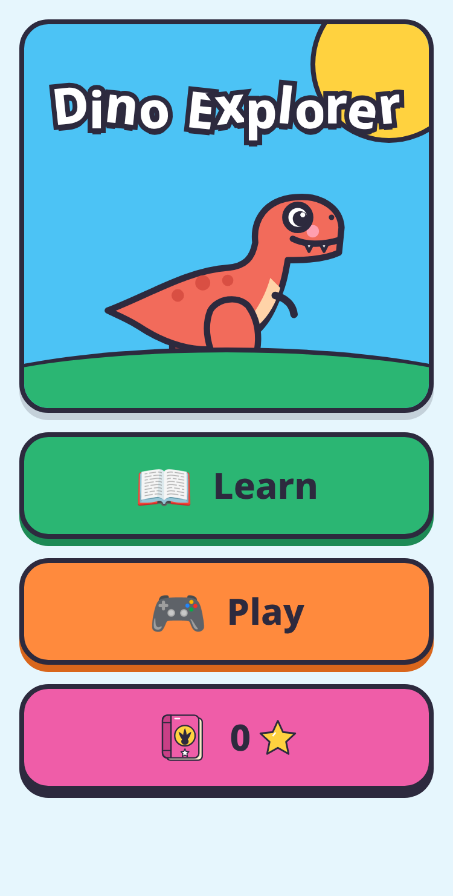
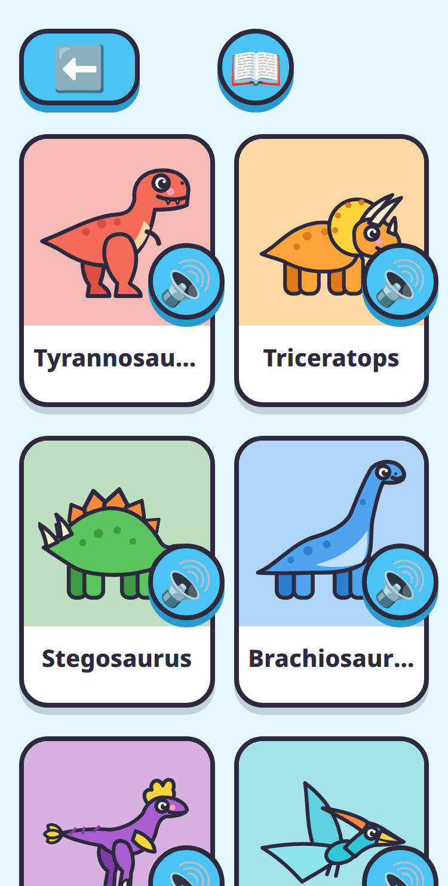
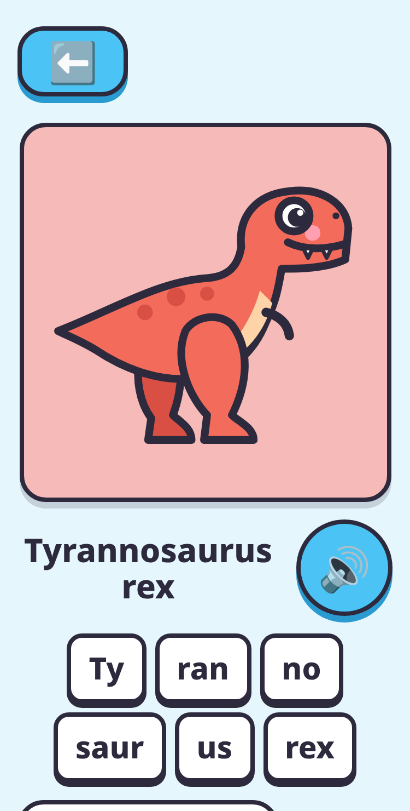
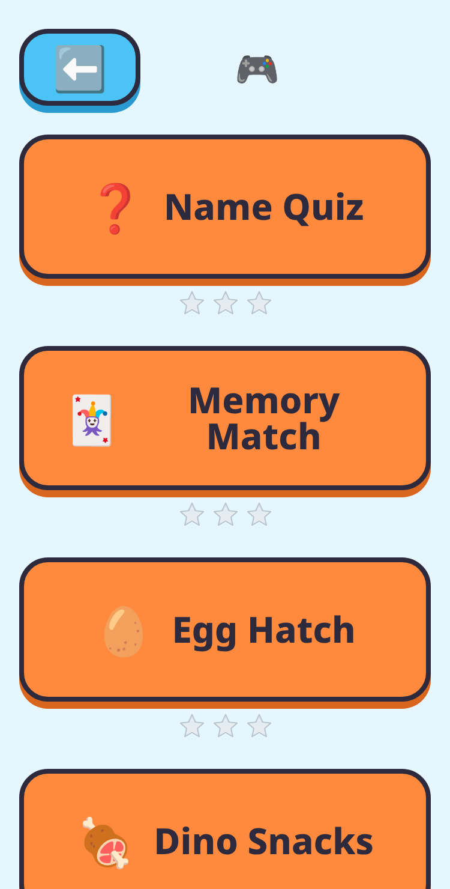
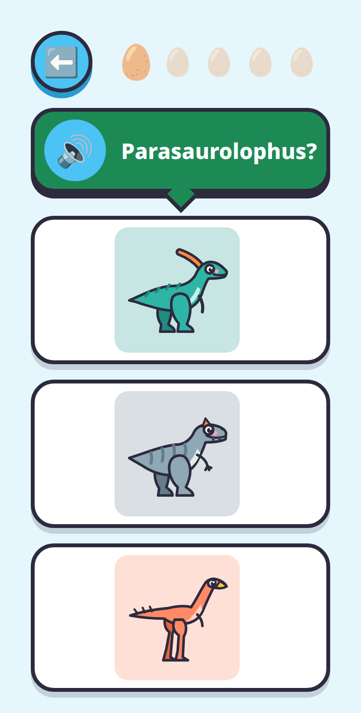

# Dino Exporer

Dino Explorer is a colorful web app that teaches children aged 4 to 8 the names of 20 prehistoric animals, from Tyrannosaurus rex to Eoraptor. Kids don't need to read: every name, syllable and fun fact is spoken aloud, and big buttons plus short games (Name Quiz, Memory Match, Egg Hatch) turn listening into play. It runs in any phone or tablet browser with no accounts, ads or tracking, and saves progress only on the device.

a clolrful kids app that teaches a dinozaur names and with mini games

## Screenshots (375px phone)

| Home | Learn | Dino detail | Play |
|---|---|---|---|
|  |  |  |  |

| Name Quiz | Memory Match | Egg Hatch |
|---|---|---|
|  |  |  |

To regenerate: `npm run build && npx vite preview --port 4179`, then in another shell `npm install --no-save playwright-core && node docs/screenshots/capture.mjs` (uses the system Chrome; set `CHROME=/path/to/chrome` if needed).
